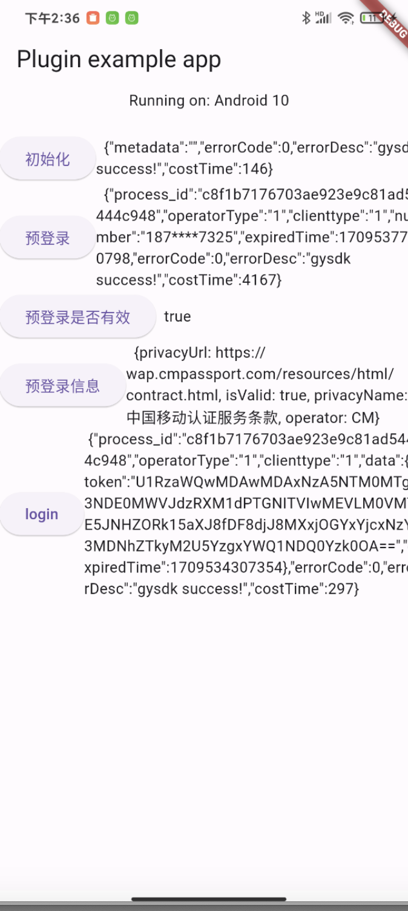
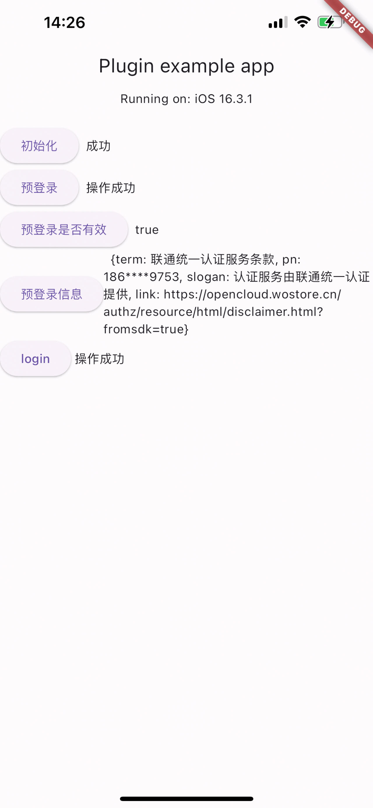
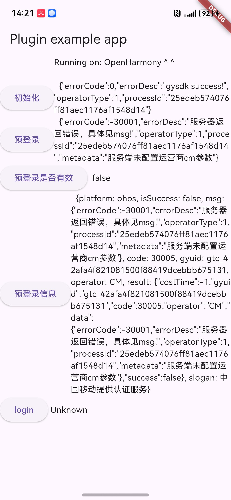

# 1、引用

Pub.dev: https://pub.dev/packages/gyflut

增加依赖：
`flutter pub add gyflut`

或者手动在工程 pubspec.yaml 中加入 dependencies：

```yaml
dependencies:
  gyflut: ^0.0.9
```


下载依赖：

```yaml
flutter pub get
flutter run
```


# 2、配置

## 2.1 Android配置

##### 2.1.1 app的build.gradle配置

到个推官网申请appID、配置签名文件

```groovy
defaultConfig {
        applicationId "自己填"
        //.......
        manifestPlaceholders = [
                GETUI_APPID         : "自己填",//请填写开发者在 https://dev.getui.com/ 申请的GETUI_APPID
                GT_INSTALL_CHANNEL: "getui",//请填写开发者需要的channel
        ]
    }
```

```groovy
signingConfigs {
        myConfig {
            storeFile file("自己填")//请换成开发者自己的签名配置
            keyAlias '自己填'
            keyPassword '自己填'
            storeFile file('../自己填')
            storePassword '自己填'
        }
    }

    buildTypes {
        debug {
            minifyEnabled false
            signingConfig signingConfigs.myConfig
            proguardFiles getDefaultProguardFile('proguard-android.txt'), 'proguard-rules.pro'
        }
        //..........
        }
```

配置依赖，最新版本见官网： https://docs.getui.com/geyan/mobile/android/init/

```groovy
dependencies {
    //-----集成个验SDK-----
    //一键认证sdk
    implementation 'com.getui:gysdk:3.2.0.0'
    //个推公共库，如已接其他个推sdk则保留一个最高版本即可
    implementation 'com.getui:gtc:3.2.18.0'
}
```


##### 2.1.2 project的build.gradle配置

```groovy
allprojects {
    repositories {
        maven {
           //仓库配置
            url "https://mvn.getui.com/nexus/content/repositories/releases/"
        }
       //....
    }
}
```
## 2.2 IOS配置
在你项目的main.dart中添加下列代码：
```dart
/// preLoginUseCache:预登录是否使用缓存，默认为true
/// debug:是否开启SDK的debug模式，默认false
/// operatorDebug:是否开启运营商的debug模式，默认false
/// appId: appid（ios)
/// preLoginTimeout: 预登录超时时长（ios)
/// eloginTimeout:登录超时时长（ios)
 Gyflut().initGySdk(true, true, false, "5xpxEg5qvI9PNGH2kQAia2");
```


## 2.3 ohos配置
*  引入插件, 见上文
* 使用鸿蒙定制版 Flutter，否则报错依赖缺失, 下载地址: [OpenHarmony Flutter](https://gitcode.com/openharmony-tpc/flutter_flutter) 及 [使用教程](https://developer.huawei.com/consumer/cn/blog/topic/03178381351651116)。
* [启动应用教程](https://gitcode.com/openharmony-tpc/flutter_flutter#%E6%9E%84%E5%BB%BA%E6%AD%A5%E9%AA%A4)

首次构建示例，或移动、更换 Flutter SDK 后，请先在 `example` 目录下用鸿蒙版 Flutter 执行：

```sh
flutter pub get
flutter build hap --debug
```

确认 `flutter --version` 显示鸿蒙定制版（本示例验证使用 `3.22.1-ohos-1.0.4`），再用 DevEco Studio 打开 `example/ohos`。如果遇到 `Cannot find module 'flutter-hvigor-plugin'`，用上述命令重新生成依赖：`flutter build hap` 会从当前 Flutter SDK 安装 Hvigor 插件，单独运行 `ohpm install` 不会安装它。

### 2.3.1 build-profile.json5配置
 ohos工程兼容字节码包、配置正确的签名信息,在项目级build-profile.json5:
```yaml
    "products": [
      {
        "name": "default",
        "signingConfig": "签名信息",
        "compatibleSdkVersion": "5.0.0(12)",
        "runtimeOS": "HarmonyOS",
        "buildOption": {
          "strictMode": {
            "useNormalizedOHMUrl": true
          }
        }
      }
    ],
```
### 2.3.2 OHOS 登录页面

登录按钮、加载状态和结果提示可由 Flutter 实现。个验 SDK 调用仍需要归属当前 ArkUI 页面树的 `CustomDialogController`，由插件的 `GyLoginDialogHost` 创建和管理。

在 [Index.ets](example/ohos/entry/src/main/ets/pages/Index.ets) 中，从当前页面的 FlutterEngine 取出已注册的插件实例，在 `FlutterPage` 旁挂载宿主组件：

```typescript
import GysdkFlutterPlugin, { GyLoginDialogHost } from 'gyflut'
import EntryAbility from '../entryability/EntryAbility'

// 以下是 Index 组件中的关键成员。viewId 沿用 Flutter 页面模板。
private plugin: GysdkFlutterPlugin | null = null

aboutToAppear(): void {
  const plugin = EntryAbility.getInstanse()?.getFlutterEngine()?.getPlugins()?.get('gyflut')
  this.plugin = plugin instanceof GysdkFlutterPlugin ? plugin : null
}

build() {
  Column() {
    FlutterPage({ viewId: this.viewId })
    GyLoginDialogHost({ plugin: this.plugin })
  }
}
```

不要另建插件实例，也不需要在 `Index.ets` 中创建或设置弹窗控制器。当前 Engine 的注册方式见 [EntryAbility.ets](example/ohos/entry/src/main/ets/entryability/EntryAbility.ets)。

### 2.3.3 配置 `module.json5`
在项目中配置：
```yaml
    "requestPermissions": [
      {"name" :  "ohos.permission.INTERNET"},
    ],
    "metadata": [
      {
        "name": "GETUI_APPID",
        "value": '你的appid',
      },
      {
        "name": "GT_INSTALL_CHANNEL",
        "value": 'CHANNEL'
      }]
}
```

### 2.3.4 插件注册

使用鸿蒙版 Flutter 构建 HAP 时会自动生成 `GeneratedPluginRegistrant`。在 `EntryAbility.configureFlutterEngine()` 中保留 `GeneratedPluginRegistrant.registerWith(flutterEngine)`。

#  3、使用

```dart
import 'package:gyflut/gyflut.dart';
```

## 3.1 API

```dart
final gyflut = Gyflut();

/**
* 初始化
* preLoginUseCache:预登录是否使用缓存，默认为true
* debug:是否开启SDK的debug模式，默认false
* operatorDebug:是否开启运营商的debug模式，默认false
* appId: appid（ios)
* preLoginTimeout: 预登录超时时长（ios)
* eloginTimeout:登录超时时长（ios)
*/
gyflut.initGySdk(true, true, false, '你的 iOS AppID');


//预登录
gyflut.ePreLogin();

//预登录是否有效
bool? isPreLoginResultValid = await gyflut.isPreLoginResultValid();

//预登录信息
Map<dynamic, dynamic>? getPreLoginResult = await gyflut.getPreLoginResult();

//登录
gyflut.login();
```


### 3.2 Android demo

https://github.com/GetuiLaboratory/getui-gysdk-flutter/tree/main/example/android




### 3.3 IOS demo
https://github.com/GetuiLaboratory/getui-gysdk-flutter/tree/main/example/ios




### 3.4 ohos demo

[Flutter 示例](example/lib/main.dart)使用同一个 `Gyflut` 实例，先注册回调，再由按钮分别调用初始化、预登录和登录。等待初始化成功后再预登录，根据回调结果继续登录。

```dart
final gyflut = Gyflut();
gyflut.addEventHandler(
  initGySdkCallBack: (event) async { /* 更新初始化状态 */ },
  preloginCallback: (event) async { /* 更新预登录状态 */ },
  loginCallBack: (event) async { /* 更新登录状态 */ },
);

// 分别绑定到三个按钮，不要在初始化发出后立即调用后两项。
void onInitPressed() => gyflut.initGySdk(true, false, false);
void onPreLoginPressed() => gyflut.ePreLogin();
void onLoginPressed() => gyflut.login();
```

OHOS 的 `ePreLogin([timeout])` 和 `login([timeout])` 使用毫秒，默认和最小值都是 `5000`。本示例使用无可见原生弹窗的登录方式，回调中无需调用 `closeAuthLoginPage()`。


